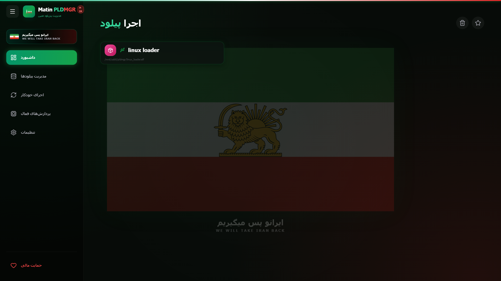

<p align="center">
  
</p>

<h1 align="center">Matin PLDMGR | مدیریت پی‌لود متین</h1>

<p align="center">
  <strong>داشبورد مدرن، بومی و اختصاصی تحت وب برای مدیریت، انتقال و اجرای خودکار پی‌لودها روی پلی‌استیشن ۵ (PS5)</strong>
</p>

<p align="center">
  <em>«ایرانـو پس می‌گیریـم • We Will Take Iran Back»</em>
</p>

<p align="center">
  <a href="#-امکانات-و-ویژگیها"></a>
  <a href="#-روشهای-نصب-و-اجرا"></a>
  <a href="#-توسعه-و-کامپایل-از-سورس"></a>
  <a href="#-توسعه-و-کامپایل-از-سورس"></a>
</p>

---

<p align="center">
  
</p>

---

## 🌟 معرفی پروژه
**Matin PLDMGR** یک نسخه شخصی‌سازی‌شده و پیشرفته از دیمن بومی مدیریت پی‌لود پلی‌استیشن ۵ است که با هویت ملی ایرانی، نشان اصیل شیر و خورشید، پالت رنگی سبز و سرخ، پشتیبانی کامل از فونت وزیرمتن و زبان فارسی روان بازطراحی شده است. این ابزار به عنوان یک وب‌سرور سبک بومی به صورت دیمن در پس‌زمینه کنسول اجرا شده و کنترل کامل پی‌لودها را در اختیارتان قرار می‌دهد.

---

## 🚀 امکانات و ویژگی‌ها

- 🌐 **رابط کاربری مدرن تحت وب:** دسترسی سریع و آسان به داشبورد از طریق کامپیوتر شخصی، تلفن همراه، تبلت یا مرورگر داخلی پلی‌استیشن ۵.
- 🦁 **تم و نماد اختصاصی ایران:** پس‌زمینه واترمارک پرچم شیر و خورشید، پالت رنگی اختصاصی سبز زمردی (`#16a34a`) و سرخ پررنگ (`#dc2626`) به همراه شعار *«ایرانو پس میگیریم / We will take Iran back»*.
- 🗂️ **کارت‌های شیشه‌ای تیره با خوانایی بالا:** طراحی مدرن کارتی (Frosted Obsidian Glass) با تاری پس‌زمینه و حاشیه‌های درخشان جهت دید شفاف و خوانا بودن محتوا.
- ⚡ **بارگذاری و انتقال پی‌لودها:** اضافه کردن مستقیم فایل‌های `.elf` از حافظه فلش USB یا دانلود آسان از مخازن ابری (Repositories).
- 🔄 **اجرای خودکار هوشمند (Autoload):** امکان چیدن صف و اولویت‌بندی پی‌لودها برای بارگذاری خودکار هنگام روشن شدن کنسول به همراه شمارش معکوس و قابلیت لغو یا مکث.
- 🎮 **آیکون اختصاصی در صفحه اصلی PS5 (Home Screen):** نصب شورتکات برنامه همراه با آیکون باکیفیت 1024x1024 شیر و خورشید روی منوی اصلی داشبورد کنسول (`assets/icon0.png`).
- 📊 **مدیریت پردازش‌ها و پی‌لودهای برگزیده:** پایش پردازش‌های فعال سیستم‌عامل، امکان بستن پروسه‌ها و ستاره‌دار کردن پی‌لودهای محبوب برای دسترسی فوری.
- 🌐 **پشتیبانی چندزبانه:** زبان فارسی به عنوان زبان اصلی با پشتیبانی کامل از فونت فارسی استاندارد و امکان تغییر به انگلیسی و سایر زبان‌ها.

---

## 📥 روش‌های نصب و اجرا

### روش ۱: استفاده با لودرهای خودکار (پیشنهادی)
بهترین و پایدارترین راه اجرای پی‌لود منیجر، استفاده از لودرهای خودکار جیلبریک است:

- **[Y2JB (YouTube to Jailbreak)](https://github.com/itsPLK/ps5-y2jb-autoloader)**
- **[BD-JB (Blu-ray Disc)](https://github.com/itsPLK/ps5-bdjb-autoloader)**
- **[Lua Autoloader](https://github.com/itsPLK/ps5-lua-autoloader)**

فایل کامپایل‌شده `pldmgr.elf` را درون پوشه `autoload` کپی کرده و نام آن را در فایل `autoload.txt` به عنوان پی‌لود پیش‌فرض ثبت کنید.

---

### روش ۲: ارسال دستی از طریق شبکه (Netcat / Socat)
می‌توانید فایل باینری را مستقیماً از کامپیوتر به پورت **9021** (یا **9020**) کنسول ارسال کنید:

#### ارسال با PowerShell در ویندوز:
```powershell
$ps5_ip = "192.168.1.XXX" # آی‌پی کنسول در شبکه محلی
$bytes = [System.IO.File]::ReadAllBytes(".\pldmgr.elf")
$tcpClient = New-Object System.Net.Sockets.TcpClient($ps5_ip, 9021)
$stream = $tcpClient.GetStream()
$stream.Write($bytes, 0, $bytes.Length)
$stream.Close()
$tcpClient.Close()
```

#### ارسال با دستور Netcat (مک / لینوکس / ترمینال ویندوز):
```bash
nc -w 3 <PS5_IP> 9021 < pldmgr.elf
```

---

### روش ۳: از طریق حافظه فلش USB
فایل `pldmgr.elf` را روی ریشه حافظه فلش USB با فرمت exFAT درون مسیری مانند `/pldmgr/` قرار داده و با استفاده از لودر یا اکسپلویت وب لود کنید.

---

## 🛠️ توسعه و کامپایل از سورس

پروژه به صورت بومی با محیط **Docker** و ابزارهای کامپایلر `prospero-clang` (بر پایه FreeBSD x86_64) ساخته می‌شود:

### ۱. بیلد بخش فرانت‌اند (React):
```bash
cd frontend
npm install
npm run build
```

### ۲. بیلد ایمیج داکر SDK (شامل کامپایلر، libmicrohttpd، mbedTLS و libcurl):
```bash
docker build -t ps5-payload-sdk-pldmgr -f Dockerfile.sdk .
```

### ۳. کامپایل نهایی فایل ELF:
```bash
docker run --rm -v "${PWD}:/src" -w /src ps5-payload-sdk-pldmgr make clean all
```
پس از اتمام فرایند، باینری آماده `pldmgr.elf` در ریشه مخزن تولید خواهد شد.

---

## 📁 ساختار مخزن

- `src/` — کدهای سی (C) دیمن بومی PS5 (سرور HTTP، بارگذار ELF، مدیریت پردازش‌ها و نصب‌کننده آیکون).
- `frontend/` — پروژه React و Tailwind CSS (داشبورد تعاملی وب).
- `assets/` — دارایی‌های گرافیکی کنسول شامل آیکون 1024x1024 شیر و خورشید (`icon0.png`) و مشخصات تایتل (`param.json`).
- `include/` — هدرهای C پروژه و هدرهای خودکار دارایی‌های تعبیه‌شده (`assets_*.h`).
- `tools/` — اسکریپت‌های تبدیل کدهای فرانت‌اند و گواهی‌ها به آرایه‌های هگز C.

---

## 🤝 قدردانی و منابع (Credits)
- **John Törnblom** برای ابزار [PS5 Payload SDK](https://github.com/ps5-payload-dev/sdk)
- **itsPLK** برای توسعه ساختار اولیه دیمن [ps5-payload-manager](https://github.com/itsPLK/ps5-payload-manager)
- تمامی محققین و توسعه‌دهندگان فعال در صحنه هوم‌برو و جیلبریک پلی‌استیشن ۵

---

<p align="center">
  <em>توسعه‌یافته و اختصاصی‌شده توسط <strong>متین (Matin)</strong></em><br />
  <strong>زنده باد ایران 🦁☀️</strong>
</p>
